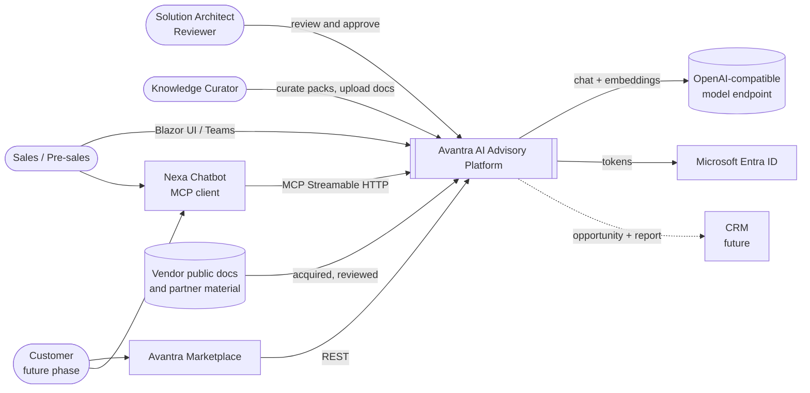
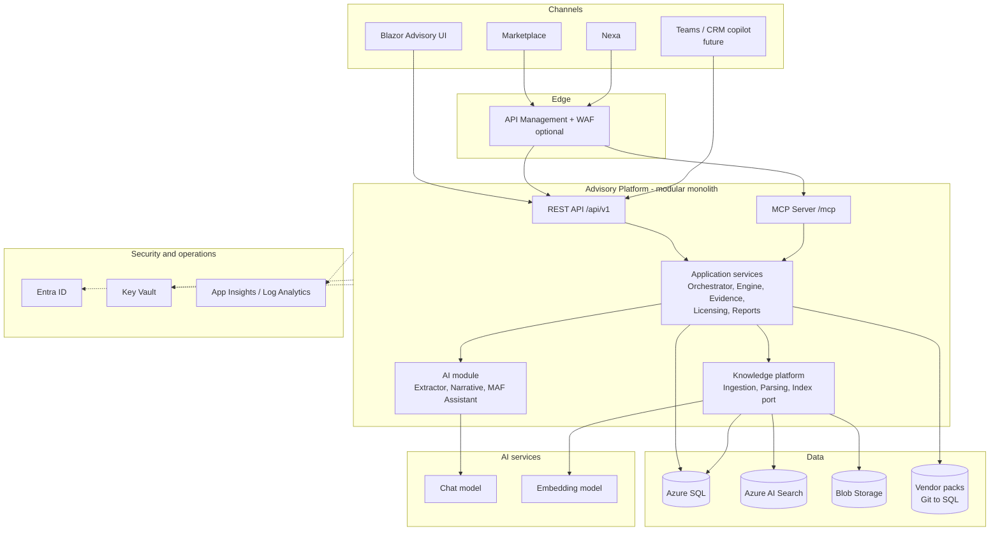
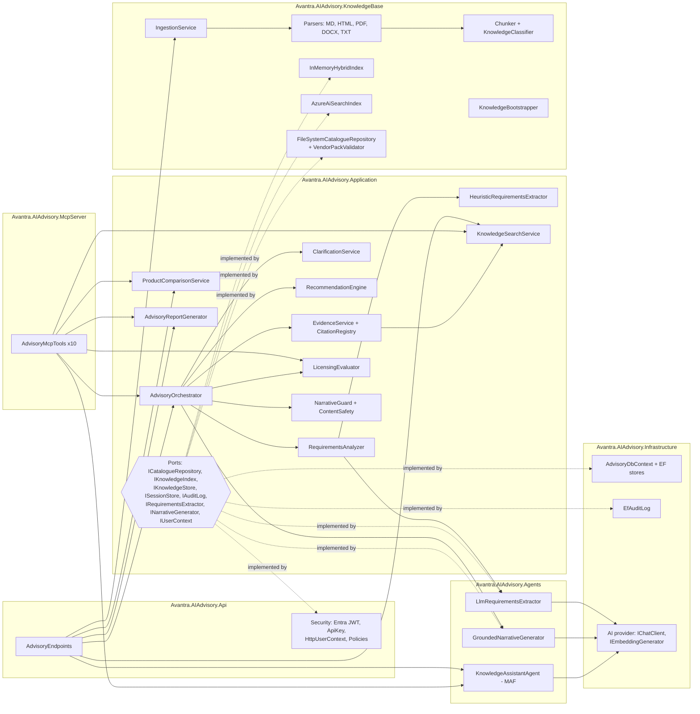
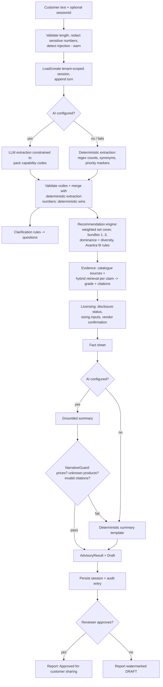
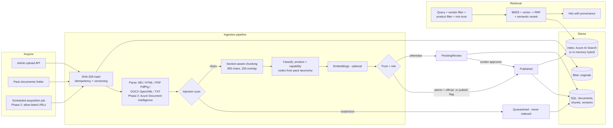
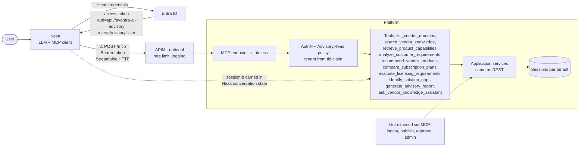
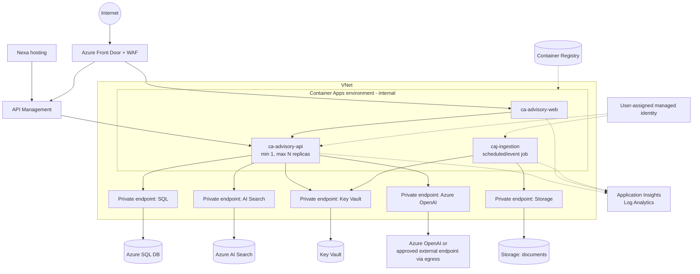
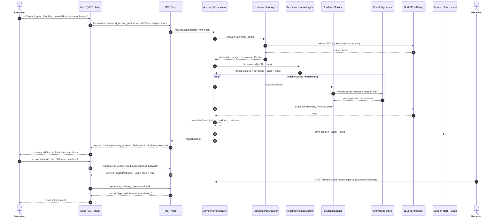

# 02 — Enterprise Architecture

> Deliverables covered: (4) enterprise architecture document, (5) high-level and detailed diagrams, (6) technical component specifications, (12) .NET solution structure. Also **Step 2 — Recommend** (architecture alternatives) and **Step 3 — Design**.

## 1. Architecture principles

| Principle | How it is applied |
|---|---|
| **Deterministic core, probabilistic edges** | Product selection, scoring and licensing logic are deterministic C#. LLMs extract structure from text and write prose, and both outputs are validated. |
| **Evidence or silence** | Every product/capability claim links to a cited source with a trust level. Unknown is said explicitly; prices are never generated. |
| **API-first, channel-agnostic** | One set of application services; REST and MCP are thin adapters; Web, Nexa, CRM and portals are clients. |
| **Modular monolith first** | One deployable with strict module boundaries; split only when scale, team or isolation needs prove it. |
| **Vendor packs, shared platform** | Vendor knowledge is data (versioned packs); the platform code is vendor-agnostic. |
| **Clean Architecture** | Domain ← Application (ports) ← Infrastructure/KnowledgeBase/Agents (adapters) ← Hosts (Api, Web). |
| **Secure by default** | Entra ID, RBAC, tenant scoping in every query, read-only MCP tools, quarantine-on-ingest, audit for every run. |
| **Swappable AI** | Only `Microsoft.Extensions.AI` abstractions (`IChatClient`, `IEmbeddingGenerator`) are used; the provider and model are configuration. |
| **Observable** | OpenTelemetry → Azure Monitor; AI calls traced (no sensitive content); audit entries per action. |

## 2. Recommended architecture vs alternatives

| Decision | Options considered | Choice | Rationale / trade-off |
|---|---|---|---|
| Deployment style | Microservices (ingestion, search, recommendation, MCP, reports…) vs **modular monolith** | **Modular monolith** (1 API host + 1 Web host) + background ingestion later | Low traffic (hundreds of runs per day), one team, shared data. Microservices would add network hops, distributed transactions and DevOps cost with no benefit yet. Module seams (projects and ports) allow a later split: ingestion is the first candidate (Azure Functions/Container Apps Job). |
| Reasoning | Autonomous agent / multi-agent vs **orchestrated pipeline** | **Pipeline** with 2 bounded LLM steps; MAF agent only for open Q&A | Reproducibility, auditability, testability, cost. Multi-agent adds latency and failure modes; reconsider for proposal generation (doc 04 §6). |
| Primary interface | MCP only vs **REST + MCP** | **Both**; REST is primary | Not all consumers are LLMs. MCP is a protocol adapter for AI clients. |
| MCP transport | stdio vs SSE vs **Streamable HTTP (stateless)** | Streamable HTTP, stateless, hosted at `/mcp` in the API | Remote, scalable, standard auth. Conversation state lives in platform sessions, not in the transport. |
| Catalogue store | SQL tables vs **versioned JSON packs (catalogue-as-code)** | Packs in Git for the MVP → SQL + admin portal in Phase 2 | PR review gives curator governance on day one with zero UI. SQL becomes needed once non-developers curate (DDL in doc 03). |
| Retrieval | Vector-only vs **hybrid (BM25 + vector + semantic rerank)** | Hybrid with RRF; Azure AI Search in production, in-process equivalent for dev/tests | Product names and codes need lexical match; concepts need vectors. |
| Knowledge graph | Graph DB vs **relational + capability model** | Relational edges (product–capability–requirement) | The "graph" is small, typed and well known. SQL plus the in-memory model handles it. A graph DB (Cosmos DB Gremlin) only if cross-vendor ontology traversal grows (doc 03 §6). |
| Agent framework | Semantic Kernel vs **Microsoft Agent Framework** vs none | **Microsoft.Extensions.AI** everywhere + **Microsoft Agent Framework** (`ChatClientAgent`) for the Q&A agent | MAF is Microsoft's successor to SK agents and AutoGen, built on M.E.AI. SK is not needed as a direct dependency. |
| Frontend | React/Angular vs **Blazor Web App** vs embed in existing | **Blazor (Interactive Server)** for demo/internal tools; Marketplace integrates via API | Same language and team as the backend; fast to build internal tools. Customer-facing Marketplace UI keeps its own stack and calls the API. |
| Hosting | App Service vs AKS vs **Azure Container Apps** | **Container Apps** (API, Web, ingestion job) | Scale to zero, managed identity, VNet integration, KEDA jobs, without the operational cost of AKS. App Service is an equally valid choice. |

## 3. Architecture views

### 3.1 Business architecture

**Capabilities**: Requirements Discovery → Solution Fit Analysis → Licensing Guidance → Evidence & Compliance → Proposal/Report → Knowledge Curation → Demand Insights.

**Value streams**:
1. *Lead → qualified opportunity*: customer/sales describes needs → advisory session → clarifications → recommendation → reviewer approval → report → CRM opportunity.
2. *Vendor knowledge → trusted catalogue*: acquire source → ingest → classify → curator verifies → publish → used in advice → refresh/expire.

**Roles**: Sales (Advisory.User), Solution Architect / Reviewer (Advisory.Reviewer), Knowledge Curator (Knowledge.Admin), Platform Admin, Customer (future, restricted scope), Nexa (service principal with Advisory.User).

### 3.2 Application architecture (logical modules)

| Module | Project | Responsibility |
|---|---|---|
| Domain | `Avantra.AIAdvisory.Domain` | Catalogue, knowledge, advisory and governance models. No dependencies. |
| Application | `Avantra.AIAdvisory.Application` | Use cases and ports: RequirementsAnalyzer, ClarificationService, RecommendationEngine, EvidenceService, LicensingEvaluator, AdvisoryOrchestrator, ProductComparisonService, KnowledgeSearchService, AdvisoryReportGenerator, ContentSafety, NarrativeGuard |
| Knowledge platform | `Avantra.AIAdvisory.KnowledgeBase` | Parsers, chunker, classifier, ingestion, indexes (in-memory hybrid, Azure AI Search), vendor pack repository and validator, bootstrapper |
| AI agents | `Avantra.AIAdvisory.Agents` | LLM requirements extractor, grounded narrative generator, MAF knowledge assistant, versioned prompts |
| Infrastructure | `Avantra.AIAdvisory.Infrastructure` | EF Core (SQLite/SQL Server), session store, audit log, AI provider registration (OpenAI-compatible) |
| MCP adapter | `Avantra.AIAdvisory.McpServer` | 10 MCP tools; thin mapping to application services |
| API host | `Avantra.AIAdvisory.Api` | REST endpoints, MCP endpoint, authN/Z, ProblemDetails, OpenAPI, telemetry |
| Web host | `Avantra.AIAdvisory.Web` | Blazor advisory UI; consumes REST like any other channel |

> **Change from the suggested structure:** `Avantra.AIAdvisory.Connectors` was replaced by **vendor packs as data** (`knowledge/vendors/<vendor>/`) plus the MCP adapter project. Adding a vendor needs **no new code** unless it needs a vendor-specific rule or a live connector (e.g. reading a customer's Salesforce org usage). Those go into an `Avantra.AIAdvisory.Connectors.<Vendor>` project when they are needed.

### 3.3 Data architecture (summary — details in doc 03)

| Data | Store | Why |
|---|---|---|
| Vendor packs (capabilities, products, licensing, rules) | Git (JSON) → Azure SQL (Phase 2) | Structured, relational, curated, versioned |
| Source documents (originals) | Azure Blob Storage (versioned container, immutable) | Provenance, re-processing |
| Documents, chunks, versions, status | Azure SQL | System of record, lifecycle |
| Search index (text, vectors, metadata) | Azure AI Search | Hybrid retrieval, security trimming by filter |
| Advisory sessions & results | Azure SQL (JSON columns) | Tenant-scoped, auditable |
| Audit log | Azure SQL + Log Analytics | Compliance, investigations |
| Telemetry | Application Insights | Operations, AI quality signals |

### 3.4 AI architecture (summary — details in doc 04)

- `IChatClient` (M.E.AI) → OpenAI-compatible endpoint (your endpoint, Azure OpenAI v1, or Azure AI Foundry). Middleware: logging, OpenTelemetry.
- `IEmbeddingGenerator` optional → hybrid retrieval; when absent, BM25 only.
- LLM step 1: **taxonomy-constrained extraction** → validated against the pack → merged with deterministic extraction.
- LLM step 2: **grounded executive summary** from a fact sheet → `NarrativeGuard` (prices, unknown products, invalid citations) → fallback template.
- MAF `ChatClientAgent` with read-only tools for open Q&A, plus a price output guard.

### 3.5 Integration architecture (details in doc 05)

- **Inbound**: REST `/api/v1/*` (OpenAPI 3.1), MCP `/mcp` (Streamable HTTP), both behind Entra ID; optionally fronted by **Azure API Management** (rate limits, keys for partners, MCP governance).
- **Outbound**: model endpoint, Azure AI Search, SQL, Blob, Key Vault (all via managed identity where supported).
- **Future**: CRM (create opportunity + attach report), Teams (copilot surface), vendor APIs (usage data for the adoption advisor), Service Bus for ingestion events.

### 3.6 Security architecture (details in doc 06)

Entra ID (OIDC users, client credentials for Nexa), app roles → policies; tenant scoping in every session query; vendor isolation as a mandatory search filter; Key Vault + managed identity; private endpoints; quarantine + trust levels; audit; human approval gate.

### 3.7 Infrastructure & deployment (details in doc 07)

Azure Container Apps environment (VNet) running `api`, `web` and `ingestion-job`; Azure SQL; Azure AI Search; Storage; Key Vault; Azure OpenAI (or external endpoint via egress); Application Insights/Log Analytics; optional API Management and Front Door/WAF. IaC in Bicep (`deployment/`), CI in GitHub Actions.

---

## 4. Diagrams

### 4.1 System context



### 4.2 High-level enterprise architecture



### 4.3 Application component diagram



### 4.4 AI agent interaction flow (advisory run)



### 4.5 RAG and knowledge ingestion architecture



### 4.6 MCP and Nexa integration architecture



### 4.7 Deployment architecture (Azure)



### 4.8 Customer advisory sequence



---

## 5. Component specifications (the 17 candidate components → deployment boundaries)

| # | Component | Implemented as | Boundary (MVP) | When to split out |
|---|---|---|---|---|
| 1 | AI Advisory Orchestrator | `AdvisoryOrchestrator` | API process | Never on its own; it is the use case |
| 2 | Domain-specific advisory agents | Vendor **packs** (data) + shared engine; vendor-specific rules as data | API process | Vendor-specific code → `Connectors.<Vendor>` module |
| 3 | MCP Server | `McpServer` project, mapped at `/mcp` | API process | Separate container if MCP traffic or security posture differs (e.g. public partner MCP) |
| 4 | Knowledge Management Service | `KnowledgeSearchService`, `IKnowledgeStore` | API process | — |
| 5 | Document Ingestion Service | `IngestionService` + admin endpoint | API process | **First to split**: Container Apps Job / Functions, triggered by Blob/Service Bus, when volume or OCR load grows |
| 6 | Document Processing Pipeline | Parsers, `Chunker`, `KnowledgeClassifier`, safety scan | Library | With #5 |
| 7 | Embedding & Indexing Service | `IEmbeddingGenerator` + `IKnowledgeIndex` | Library | With #5 (or Azure AI Search integrated vectorisation) |
| 8 | Enterprise Search Service | `IKnowledgeIndex` (`AzureAiSearchIndex`) | Managed service | Already external (Azure AI Search) |
| 9 | Product Catalogue Service | `ICatalogueRepository` (packs) | Library | SQL-backed + admin portal (Phase 2) |
| 10 | Subscription & Licensing Knowledge Service | `LicensingOption` + `LicensingEvaluator` | Library | Separate restricted store if partner price books are added (strict RBAC) |
| 11 | Recommendation Engine | `RecommendationEngine` | Library | Never (pure, fast) |
| 12 | Business Requirements Analyzer | `RequirementsAnalyzer` + extractors | Library | — |
| 13 | Conversation Context Manager | `AdvisorySession` + `ISessionStore` (tenant-scoped) | SQL | Redis cache only if latency requires |
| 14 | Citation & Evidence Service | `EvidenceService`, `CitationRegistry`, `EvidenceGrade` | Library | — |
| 15 | Advisory Report Generator | `AdvisoryReportGenerator` (Markdown → HTML) | Library | DOCX/PDF rendering worker if heavy templating is needed |
| 16 | Nexa Integration Adapter | **MCP tools** (no separate adapter needed) | API process | Only if Nexa cannot speak MCP → REST façade with Nexa-specific shaping |
| 17 | Admin & Knowledge Portal | Admin endpoints now; Blazor admin pages Phase 2 | Web | — |

## 6. .NET solution structure (as built)

```
Avantra.AIAdvisory.sln
├─ Directory.Build.props / Directory.Packages.props (central package management) / global.json
├─ src/
│  ├─ Avantra.AIAdvisory.Domain           (no dependencies)
│  ├─ Avantra.AIAdvisory.Application      (→ Domain, M.E.AI.Abstractions)
│  ├─ Avantra.AIAdvisory.KnowledgeBase    (→ Application; PdfPig, OpenXML, Azure.Search.Documents)
│  ├─ Avantra.AIAdvisory.Agents           (→ Application; M.E.AI, Microsoft.Agents.AI)
│  ├─ Avantra.AIAdvisory.Infrastructure   (→ Application; EF Core, M.E.AI.OpenAI)
│  ├─ Avantra.AIAdvisory.McpServer        (→ Application, Agents; ModelContextProtocol.AspNetCore)
│  ├─ Avantra.AIAdvisory.Api              (host: composes all modules; /api/v1 + /mcp)
│  └─ Avantra.AIAdvisory.Web              (host: Blazor UI; → Domain contracts only)
├─ tests/
│  ├─ Avantra.AIAdvisory.UnitTests        (engine, extraction, guards, parsers, index, pack validation)
│  └─ Avantra.AIAdvisory.IntegrationTests (WebApplicationFactory: REST, auth, tenant isolation, AI path, MCP client)
├─ knowledge/
│  ├─ vendors/planview/pack.json + documents/
│  └─ samples/poisoned-datasheet.md        (security demo)
├─ docs/
└─ deployment/ (Bicep, Dockerfiles, CI)
```

**Dependency rule**: arrows point inward only. `Application` knows nothing about EF, OpenAI, Azure Search or MCP, so it can be unit-tested with no infrastructure (`UnitTests` do exactly that against the real Planview pack).

## 7. Technology versions and maturity (as of Nov 2026)

| Technology | Version used | Status | Note |
|---|---|---|---|
| .NET / ASP.NET Core | **10 (LTS)** | GA, supported to Nov 2028 | .NET 11 is GA but STS; stay on LTS for production |
| EF Core | 10.0.x | GA | SQLite (dev) / SQL Server & Azure SQL (prod) |
| Microsoft.Extensions.AI (+ .OpenAI) | 10.11.x | GA | Provider abstraction (`IChatClient`, `IEmbeddingGenerator`) |
| Microsoft Agent Framework (`Microsoft.Agents.AI`) | 1.28.x | GA (1.x) | Used for the Q&A agent; workflows/multi-agent features should be evaluated per feature for preview status |
| MCP C# SDK (`ModelContextProtocol.AspNetCore`) | 2.4.x | GA | Streamable HTTP, stateless mode |
| Azure.Search.Documents | 12.1.x | GA | Hybrid + vector + semantic ranker |
| PdfPig | 0.1.16 | Stable OSS (pre-1.0 versioning) | Text PDFs; use Azure Document Intelligence for scanned/complex layouts |
| DocumentFormat.OpenXml | 3.5.x | GA (Microsoft) | DOCX |
| Blazor Web App | .NET 10 | GA | Interactive Server |
| Semantic Kernel | — | GA, not used | MAF supersedes SK agent features; no need for both |

> Re-verify versions and preview flags at implementation time. Anything marked "preview" in Azure (for example agentic retrieval features in Azure AI Search, or MCP features in API Management) should not be on the critical path until GA.
