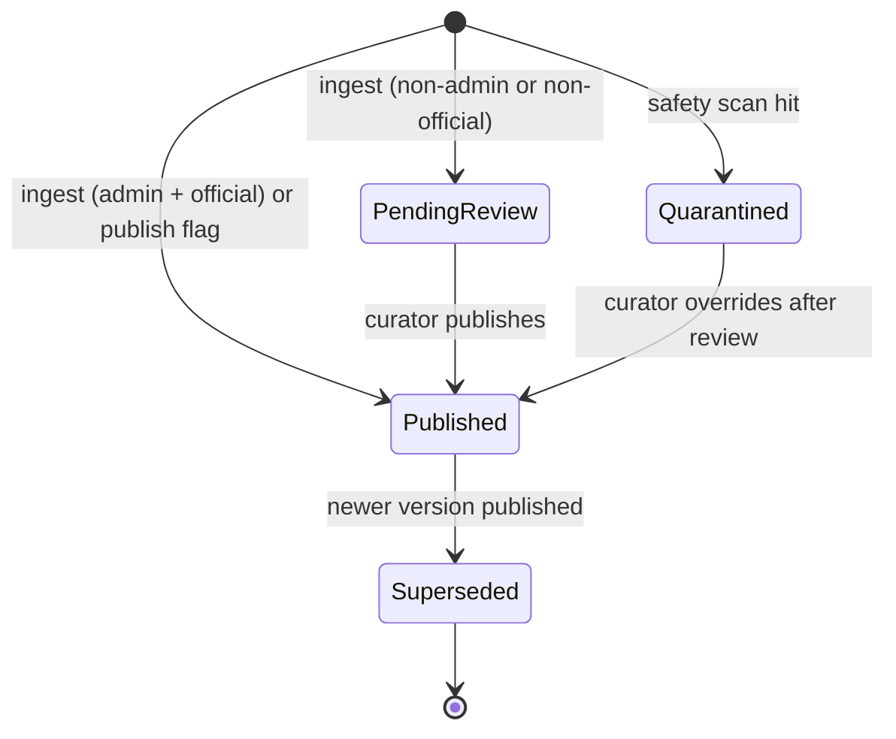

# 03 — Knowledge Engineering & Data Architecture

> Deliverables covered: (7) data and knowledge architecture, (13) database and domain models, (17) sample knowledge base and ingestion pipeline.

## 1. The core idea: two kinds of knowledge

Vendor knowledge comes in two different forms, and treating both as "documents to embed" is the most common mistake in advisory RAG systems.

| | **Structured knowledge (the catalogue)** | **Unstructured knowledge (the corpus)** |
|---|---|---|
| Examples | Product X provides capability Y at level Core; licence option Z is NotPublic; Avantra fit rule R | Datasheets, docs, implementation guides, release notes, playbooks |
| Role | **Decides** — the recommendation engine only reasons over this | **Supports and explains** — evidence passages, Q&A, discovery of new facts |
| Store | Versioned pack (Git JSON → SQL) | Blob (originals) + SQL (chunks/versions) + Search index |
| Quality control | Curator verification per entry (`verification`, `verifiedOn`) | Trust level per source, review-before-publish, quarantine |
| Failure mode if wrong | Wrong recommendation (caught by review and tests) | Weak or irrelevant citation (graded, never sole basis for a claim) |

The pipeline turns unstructured into structured: documents are ingested, classified and searchable; **curators** (assisted by AI extraction, Phase 2) promote facts into the catalogue with source references. The engine never treats an LLM's reading of a document as a fact until a curator has accepted it.

## 2. Knowledge pack (per vendor) — the unit of isolation and reuse

```
knowledge/vendors/<vendor>/
├─ pack.json        # vendor, capabilities, products, licensingOptions, fitRules, clarificationRules
└─ documents/       # source documents with front matter (title, source_url, trust, products, retrieved_on)
```

- **Shared** across vendors: domain model, ingestion, parsers, index, engine, evidence, report, MCP/REST.
- **Per vendor**: capability taxonomy, product catalogue, licensing disclosure, Avantra fit rules, clarification rules, corpus.
- **Isolation**: every chunk carries `vendorCode`; every search requires a vendor filter, applied *before* ranking; sessions are bound to one vendor. A cross-vendor advisory (Phase 5+) is an explicit composition of several packs, never an unfiltered search.
- **Validation**: `VendorPackValidator` refuses to load a pack with broken references, unsourced products or capabilities, "public terms" on non-public licensing, or unknown products in rules. CI runs it through the unit test `Shipped_planview_pack_passes_validation`.

### 2.1 Pack schema (JSON, abridged)

```jsonc
{
  "vendor": { "code": "planview", "name": "Planview", "packVersion": "0.1.0-demo",
              "dataDisclaimer": "...", "isDemonstrationData": true },
  "capabilities": [ { "code": "resource-management", "name": "Resource management", "category": "Resources",
                      "description": "...", "synonyms": ["resource planning", "resourcing"] } ],
  "products": [ { "code": "planview-portfolios", "name": "Planview Portfolios", "aliases": ["Enterprise One"],
                  "summary": "...", "solutions": ["Strategic Portfolio Management"], "deploymentModels": ["SaaS"],
                  "capabilities": [ { "capabilityCode": "resource-management", "coverage": "Core", "notes": null,
                                      "evidence": [ { "documentId": "...", "title": "...", "url": "...",
                                                      "section": "Capabilities", "trust": "VendorOfficial", "retrievedOn": "2026-11-01" } ] } ],
                  "sources": [ ... ], "verification": "Verified", "verifiedOn": "2026-11-01",
                  "implementationConsiderations": [ "..." ] } ],
  "licensingOptions": [ { "code": "...", "productCode": "planview-portfolios", "name": "...",
                          "disclosure": "NotPublic", "licenseMetric": "Not publicly documented - confirm with Planview",
                          "sizingDrivers": ["portfolioManagers", "projectManagers"], "publicTerms": null, "sources": [ ... ] } ],
  "fitRules": [ { "code": "avr-agile-portfolio-connect", "when": { "methodology": "hybrid", "capabilityPresent": "portfolio-management" },
                  "productCodes": ["planview-portfolios", "planview-agileplace"], "scoreAdjustment": 0.06,
                  "rationale": "...", "requiresBusinessConfirmation": true } ],
  "clarificationRules": [ { "code": "q-method", "field": "methodology", "question": "...", "whyItMatters": "...", "priority": 1 } ]
}
```

## 3. Ingestion pipeline (implemented)

| Stage | Implementation | Notes / Phase 2 upgrade |
|---|---|---|
| **Acquisition** | Admin upload (`POST /api/v1/knowledge/documents`), pack `documents/` seeding at startup | Scheduled acquisition from an **allow-list** of official URLs with ToS check; partner-portal exports by curators. No uncontrolled crawling. |
| **Idempotency / versioning** | SHA-256 of bytes; same `externalId` + same hash → `Unchanged`; changed → new version; old version `Superseded` and removed from index on publish | Originals stored in Blob with versioning and immutability policies |
| **Parsing** | `MarkdownParser` (front matter), `HtmlParser` (drops nav/script/head), `PdfParser` (PdfPig, page sections), `DocxParser` (Open XML heading styles), `PlainTextParser` | **Azure AI Document Intelligence** (layout model) for scanned PDFs, tables and complex datasheets |
| **Safety** | `ContentSafety.LooksLikePromptInjection` → `Quarantined` | **Azure AI Content Safety Prompt Shields** (document attack detection) as a second layer |
| **Chunking** | Section-aware, ~900 chars, 150 overlap, sentence-boundary splitting; never crosses a heading | Table-aware chunking from Document Intelligence output |
| **Metadata enrichment** | Front matter (title, source_url, trust, products, retrieved_on, demonstration_data, tags) | LLM-assisted metadata (document type, effective date, product version) with curator confirmation |
| **Classification** | `KnowledgeClassifier`: product codes (names; single-word aliases matched as proper nouns only) and capability codes (taxonomy synonyms) per chunk | Embedding-similarity classification against capability descriptions as a fallback |
| **Embedding** | Optional `IEmbeddingGenerator` (batches of 16) | Or Azure AI Search integrated vectorisation |
| **Publication** | `Published` if admin and VendorOfficial, or explicit publish flag (non-quarantined); else `PendingReview` → curator `POST /documents/{id}/publish` | Approval UI in admin portal |
| **Indexing** | `IKnowledgeIndex`: `InMemoryHybridIndex` (dev/test) or `AzureAiSearchIndex` (prod) | — |
| **Audit** | `knowledge.ingest`, `knowledge.publish` entries | — |

### 3.1 Structured knowledge extraction (Phase 2 design)

```
Document (Published) ──► LLM extraction job (per section)
   prompt: "List (product, capability_code, coverage, quote) using ONLY these capability codes"
   output: candidate facts + exact supporting quote + chunk id
        ──► Validation: product & capability exist in pack; the quote is found verbatim in the chunk
        ──► Candidate queue (SQL: CatalogueCandidates) ──► Curator UI: accept / edit / reject
        ──► Accepted → pack (SQL) with SourceReference(chunk/document, section) and verifiedOn
```

The **verbatim-quote check** is a cheap, strong guard against hallucinated extraction. The same pattern applies to licensing facts, but with an extra rule: **any money amount requires a PubliclyDocumented source and a second reviewer**.

## 4. Retrieval design

**Hybrid retrieval** = lexical BM25 (product names, codes, exact terms) + vector similarity (paraphrases), fused with **Reciprocal Rank Fusion** (k = 60), then (Azure) **semantic ranker** re-ranking. Trust is applied as a mild score multiplier. The vendor/product/status/trust filters are applied *before* ranking (security trimming).

| Query pattern | Mechanism |
|---|---|
| "Does AgilePlace support WIP limits?" | Product filter + hybrid |
| Evidence for a (product, capability) claim | Query = product name + capability name + synonyms; product filter; top-1 above threshold |
| Open Q&A (agent) | Agent calls `search_knowledge` tool; results wrapped as `<untrusted_source>` |
| Curator discovery | Facets on capability codes / products (Azure AI Search facets) |

**RAG is used for evidence and Q&A, not for decision-making.** This is the main difference from "just another RAG chatbot".

## 5. When to use SQL, Azure AI Search, vectors, graph

| Need | Use | Why |
|---|---|---|
| Products, capabilities, coverage, licensing disclosure, rules, sessions, audit | **Azure SQL** | Relational integrity, transactions, reporting, row-level security if needed |
| Full-text + semantic search over chunks with filters/facets | **Azure AI Search** | Managed hybrid search, semantic ranker, security filters, scale |
| Paraphrase / concept matching | **Vectors** (in Azure AI Search) | Complements BM25; not a replacement |
| Product ↔ capability ↔ requirement ↔ integration relationships | **SQL edges** (the capability model *is* a small typed graph) | Few node types, known traversals (1–2 hops); SQL is enough |
| Cross-vendor ontology, integration paths ("Planview ↔ Salesforce via Hub ↔ MuleSoft"), many-hop dependency reasoning | **Graph (Phase 5+, evaluate)**: Azure Cosmos DB for Apache Gremlin, or SQL Server graph tables | Only if traversal depth and ontology size grow; start with SQL Server graph tables (`NODE`/`EDGE`) to stay in one store |

### Knowledge graph evaluation

A dedicated graph database is **not justified in phases 1–4**. The relationships needed (product–capability coverage, product–product integration, capability hierarchy) are shallow and well defined. **SQL Server/Azure SQL graph tables** give MATCH-style queries without a new technology if multi-hop questions appear, for example *"which integration path connects Planview Portfolios to Salesforce opportunities?"*. Revisit when the cross-vendor ontology exceeds ~1,000 nodes, or when integration-path reasoning becomes a product feature.

## 6. Provenance, citations and evidence grades

- Every catalogue fact carries `SourceReference(documentId, title, url, section, trust, retrievedOn)`.
- Every retrieval hit carries `(documentId, chunkId, title, url, section, trust, isDemonstrationData)`.
- `CitationRegistry` de-duplicates citations per advisory result and numbers them `C1…Cn`; coverage rows and licensing statements reference these ids. The narrative may only cite existing ids (`NarrativeGuard`).
- **Evidence grade** per claim:

| Grade | Condition |
|---|---|
| `Verified` | Product is curator-`Verified` **and** the capability evidence includes a `VendorOfficial` source |
| `DocumentSupported` | Catalogue claim + supporting passage retrieved from a published document |
| `CatalogueUnverified` | Catalogue claim with a source reference, pending curator verification |
| `Unsupported` | No source; never shown as fact |

### Source trust levels

`VendorOfficial (4)` › `PartnerVerified (3)` › `AvantraInternal (2)` › `ThirdParty (1)` › `Unverified (0)`. The demo pack uses **AvantraInternal** because its content is an Avantra summary of public positioning, not vendor documents. That is the honest classification until curators attach official sources.

## 7. Document lifecycle



**Freshness SLA (recommendation):** every catalogue product re-verified at least every 90 days and on every vendor release announcement. Documents older than 12 months are flagged in the curator dashboard. `retrievedOn` and `verifiedOn` appear in citations.

## 8. Knowledge quality evaluation

| Metric | How | Target |
|---|---|---|
| Retrieval recall@5 / MRR | Golden set of (question → expected document/section) per vendor, run in CI against the in-memory index and nightly against Azure AI Search | recall@5 ≥ 0.9 |
| Classification precision | Sample of chunks labelled by curators | ≥ 0.9 |
| Catalogue freshness | % products with `verifiedOn` < 90 days | 100% |
| Citation coverage | % of covered requirements with ≥ 1 citation (integration test enforces 100%) | 100% |
| Injection catch rate | Red-team corpus of poisoned documents | 100% quarantined or neutralised |
| Unsupported claims in narratives | `NarrativeGuard` rejections / total, plus LLM-as-judge groundedness evaluation (`Microsoft.Extensions.AI.Evaluation`) | Trend to 0 |

## 9. Database model

### 9.1 Implemented (EF Core, `AdvisoryDbContext`)

| Table | Key columns | Notes |
|---|---|---|
| `KnowledgeDocuments` | Id, VendorCode, ExternalId, Version (unique together), Title, SourceUrl, ContentHash, Trust, Status, StatusReason, ProductCodes (JSON), Tags (JSON), RetrievedOn, IngestedAt, IngestedBy, IsDemonstrationData | Lifecycle + provenance |
| `KnowledgeChunks` | Id, DocumentId (FK, cascade), Ordinal, Section, Content, ProductCodes (JSON), CapabilityCodes (JSON), Embedding (varbinary) | Source of truth to (re)build the index |
| `AdvisorySessions` | Id, TenantId, OwnerId, VendorCode, Channel, CreatedAt, UpdatedAt, Turns (JSON), LatestResultJson, Review, ReviewedBy, ReviewedAt, ReviewComment | Index (TenantId, OwnerId); **always queried with TenantId** |
| `AuditLog` | Id, At, TenantId, ActorId, Channel, Action, ResourceId, Detail, ModelUsed, CorrelationId | Append-only |

### 9.2 Target catalogue schema (Phase 2, Azure SQL)

```sql
CREATE TABLE catalogue.Vendor (
  VendorCode       nvarchar(50)  NOT NULL PRIMARY KEY,
  Name             nvarchar(200) NOT NULL,
  PackVersion      nvarchar(30)  NOT NULL,
  DataDisclaimer   nvarchar(2000) NOT NULL,
  IsDemonstration  bit NOT NULL DEFAULT 0
);
CREATE TABLE catalogue.Capability (
  VendorCode   nvarchar(50) NOT NULL REFERENCES catalogue.Vendor,
  Code         nvarchar(100) NOT NULL,
  Name         nvarchar(200) NOT NULL,
  Category     nvarchar(100) NOT NULL,
  Description  nvarchar(2000) NULL,
  ParentCode   nvarchar(100) NULL,               -- capability hierarchy
  CommonCapabilityCode nvarchar(100) NULL,       -- link to cross-vendor ontology (Phase 5)
  PRIMARY KEY (VendorCode, Code)
);
CREATE TABLE catalogue.CapabilitySynonym (VendorCode nvarchar(50), CapabilityCode nvarchar(100), Synonym nvarchar(200),
  PRIMARY KEY (VendorCode, CapabilityCode, Synonym));
CREATE TABLE catalogue.Product (
  VendorCode   nvarchar(50) NOT NULL REFERENCES catalogue.Vendor,
  Code         nvarchar(100) NOT NULL,
  Name         nvarchar(200) NOT NULL,
  Summary      nvarchar(2000) NOT NULL,
  Verification nvarchar(30) NOT NULL CHECK (Verification IN ('PendingCuratorVerification','Verified','Deprecated')),
  VerifiedOn   date NULL, VerifiedBy nvarchar(200) NULL,
  ValidFrom    datetime2 GENERATED ALWAYS AS ROW START, ValidTo datetime2 GENERATED ALWAYS AS ROW END,
  PERIOD FOR SYSTEM_TIME (ValidFrom, ValidTo),
  PRIMARY KEY (VendorCode, Code)
) WITH (SYSTEM_VERSIONING = ON (HISTORY_TABLE = catalogue.ProductHistory));   -- temporal: full change history
CREATE TABLE catalogue.ProductAlias (VendorCode nvarchar(50), ProductCode nvarchar(100), Alias nvarchar(200), IsLegacyName bit,
  PRIMARY KEY (VendorCode, ProductCode, Alias));
CREATE TABLE catalogue.ProductCapability (
  VendorCode nvarchar(50), ProductCode nvarchar(100), CapabilityCode nvarchar(100),
  Coverage nvarchar(20) NOT NULL CHECK (Coverage IN ('Core','Supported','ViaIntegration')),
  Notes nvarchar(1000) NULL,
  PRIMARY KEY (VendorCode, ProductCode, CapabilityCode)
);
CREATE TABLE catalogue.SourceReference (
  Id bigint IDENTITY PRIMARY KEY, DocumentId uniqueidentifier NULL, ExternalDocumentId nvarchar(200) NOT NULL,
  Title nvarchar(500) NOT NULL, Url nvarchar(2000) NULL, Section nvarchar(500) NULL,
  Trust nvarchar(20) NOT NULL, RetrievedOn date NULL, Quote nvarchar(2000) NULL
);
CREATE TABLE catalogue.ProductCapabilityEvidence (VendorCode nvarchar(50), ProductCode nvarchar(100), CapabilityCode nvarchar(100),
  SourceReferenceId bigint REFERENCES catalogue.SourceReference, PRIMARY KEY (VendorCode, ProductCode, CapabilityCode, SourceReferenceId));
CREATE TABLE catalogue.LicensingOption (
  VendorCode nvarchar(50), Code nvarchar(100), ProductCode nvarchar(100), Name nvarchar(200),
  Description nvarchar(2000), Disclosure nvarchar(30) NOT NULL CHECK (Disclosure IN ('NotPublic','PartnerConfidential','PubliclyDocumented')),
  LicenseMetric nvarchar(200), PublicTerms nvarchar(2000) NULL,
  Audience nvarchar(20) NOT NULL DEFAULT 'Internal' CHECK (Audience IN ('Internal','Customer')),
  CONSTRAINT CK_PublicTerms CHECK (PublicTerms IS NULL OR Disclosure = 'PubliclyDocumented'),
  PRIMARY KEY (VendorCode, Code)
);
CREATE TABLE catalogue.FitRule (VendorCode nvarchar(50), Code nvarchar(100), Description nvarchar(500), ConditionJson nvarchar(max),
  ProductCodesJson nvarchar(max), ScoreAdjustment decimal(5,3), Rationale nvarchar(1000), RequiresBusinessConfirmation bit,
  ApprovedBy nvarchar(200) NULL, PRIMARY KEY (VendorCode, Code));
CREATE TABLE catalogue.ClarificationRule (VendorCode nvarchar(50), Code nvarchar(100), Field nvarchar(50), Question nvarchar(500),
  WhyItMatters nvarchar(500), Priority int, OnlyIfCapability nvarchar(100) NULL, PRIMARY KEY (VendorCode, Code));
CREATE TABLE catalogue.CatalogueCandidate (       -- AI-extracted facts awaiting curator decision
  Id bigint IDENTITY PRIMARY KEY, VendorCode nvarchar(50), ProductCode nvarchar(100), CapabilityCode nvarchar(100),
  ProposedCoverage nvarchar(20), Quote nvarchar(2000), ChunkId uniqueidentifier, Status nvarchar(20), DecidedBy nvarchar(200) NULL
);
```

The Phase 2 `SqlCatalogueRepository` implements the same `ICatalogueRepository` port, so nothing upstream changes. A pack export/import tool keeps Git JSON as a backup and diff format.

## 10. Sample knowledge base in this repository

- `knowledge/vendors/planview/pack.json`: 20 capabilities, 10 products, 10 licensing options (all `NotPublic`), 4 Avantra fit rules, 10 clarification rules.
- `knowledge/vendors/planview/documents/`: 13 Markdown documents (product overviews, solution areas, licensing disclosure, Avantra implementation playbook).
- `knowledge/samples/poisoned-datasheet.md`: a prompt-injection/price-poisoning document used to demonstrate quarantine.

> **Important — demonstration data.** The Planview sandbox used to build this MVP could not reach planview.com. The pack is therefore an **Avantra summary of publicly known product positioning**, marked `isDemonstrationData: true`, trust `AvantraInternal`, verification `PendingCuratorVerification`, with source URLs pointing to the Planview home page instead of deep links. **No prices, tiers or licence types are stated.** Before any customer use, a curator must: (1) attach official Planview product page / datasheet URLs and sections, (2) confirm each capability mapping and coverage level, (3) set `verification: Verified` and `verifiedOn`, (4) raise trust to `VendorOfficial` where the source is a Planview document. The engine, evidence grading and disclaimers adjust automatically.
